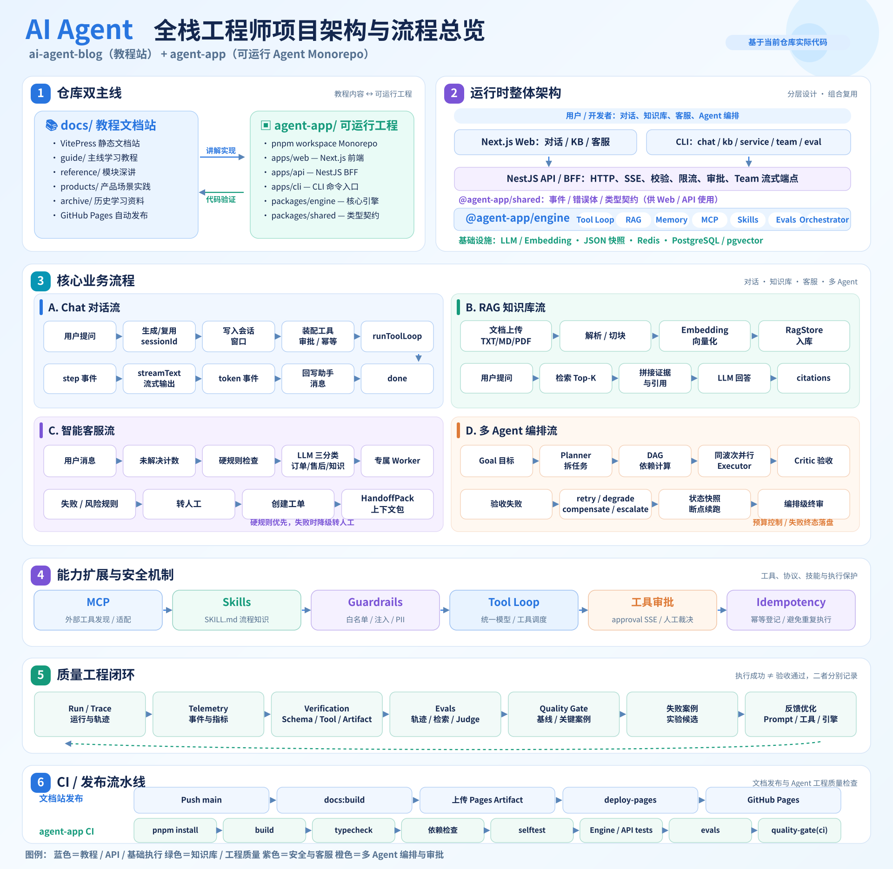

# AI Agent 工程教程 · 博客与可运行工程

<p align="center">
  
</p>

**一套以 TypeScript 为唯一主线的 AI Agent 工程教程**：从「会调 LLM API」走到「能组装生产级 Agent 系统」——手写工具循环、接记忆与 RAG、补安全与评估、做多 Agent 编排，最后交付带 Web 前端的完整应用。教程描述的每个能力都对应 `agent-app/` 里的真实实现与测试。

## 快速入口

| 你想做什么                    | 去哪里                                                                                                      |
| ----------------------------- | ----------------------------------------------------------------------------------------------------------- |
| **开始学习**（读者）          | [学习入口 · 从这里开始](./docs/start/index.md) → [七阶段主线](./docs/learn/index.md)                        |
| **运行教程站**（本地）        | `pnpm install && pnpm docs:dev` → http://localhost:5173                                                     |
| **跑起 Agent 工程**（开发者） | [agent-app README](./agent-app/README.md)（环境、命令、Docker）                                             |
| **理解架构**                  | [架构总览](#架构总览) 与 [agent-app ARCHITECTURE](./agent-app/ARCHITECTURE.md)                              |
| **查某模块的实现**            | [参考库 · 模块深讲](./docs/reference/README.md)（逐行走读 + 设计取舍）                                      |
| **看能跑的完整案例**          | [产品案例 · 阶段 07](./docs/learn/07-applications/index.md) 与 [案例库三篇](./docs/cases/knowledge-base.md) |

## 架构总览

本仓库是**教程文档 + 可运行 Agent 工程**的双主线项目：`docs/` 通过 VitePress 组织学习内容；`agent-app/` 是 pnpm workspace Monorepo，提供 TypeScript Agent 引擎、Next.js Web、NestJS API、CLI 和可选的持久化基础设施。

[](./docs/public/images/ai-agent-architecture-overview.svg)

> 点击图片查看放大的矢量架构图：仓库双主线、运行时分层、Chat / RAG / 客服 / 多 Agent 流程、MCP / Skills、安全机制、质量工程闭环和 CI 发布流程。

| 目录                                         | 核心职责                                                                    | 深入阅读                                                 |
| -------------------------------------------- | --------------------------------------------------------------------------- | -------------------------------------------------------- |
| `docs/learn/`                                | **七阶段能力主线**（01 基础 → 07 产品案例），每课有可执行示例与离线测试映射 | [主线总览](./docs/learn/index.md)                        |
| `docs/start/` `docs/advanced/` `docs/cases/` | 学习入口 / 毕业进阶 / 完整案例                                              | [从这里开始](./docs/start/index.md)                      |
| `docs/reference/`                            | 模块深讲与 API/架构契约（与 learn 分工：叙事 vs 走读）                      | [参考库](./docs/reference/README.md)                     |
| `docs/archive/weeks/`                        | 23 周按天历史课程（161 篇，原貌保留，不参与主线导航）                       | [归档索引](./docs/archive/weeks/index.md)                |
| `agent-app/apps/web/`                        | Next.js 对话、知识库、客服页面（SSE 流式）                                  | [Web README](./agent-app/apps/web/README.md)             |
| `agent-app/apps/api/`                        | NestJS REST/SSE BFF、数据校验、限流、审批、Team 端点                        | [应用说明](./agent-app/README.md)                        |
| `agent-app/apps/cli/`                        | Chat、KB、Service、Team、Eval、MCP Server 命令入口                          | [应用说明](./agent-app/README.md)                        |
| `agent-app/packages/engine/`                 | Agent Loop、工具、RAG、记忆、编排、MCP、Skills、质量工程（13 模块）         | [架构详解](./agent-app/ARCHITECTURE.md)                  |
| `agent-app/packages/shared/`                 | Web 与 API 共用的类型（纯类型零运行时）                                     | [Shared README](./agent-app/packages/shared/README.md)   |
| `docs/maintainers/`                          | 实施追踪、ADR、兼容性基线、能力矩阵（维护者文档）                           | [实施追踪](./docs/maintainers/implementation-tracker.md) |
| `.github/workflows/`                         | 站点发布 + 文档门禁 + Agent CI + 依赖审计（四条独立流水线）                 | [工作流目录](./.github/workflows/)                       |

### 能力速览（全部有离线测试背书，边界如实标注）

- **Agent Loop**：模型点名、代码执行；终止/错误回灌/abort/maxSteps
- **RAG**：切块/嵌入/检索/引用编号后端生成；内存/JSON 快照/pgvector 三存储
- **记忆**：会话/偏好/情景三层 + 压缩水位；工厂按环境变量切换后端
- **安全**：Guardrails（PII 脱敏/注入扫描/入库闸）+ 工具审批 + 幂等
- **客服产品线**：硬规则优先于 LLM 分类，Supervisor → 三工人 → Handoff 转人工
- **多 Agent 编排**：状态机 + DAG 波次并行 + 验收闭环 + 失败策略（CLI `pnpm cli team`）
- **MCP/Skills**：外部工具接入与 SKILL.md 流程知识（CLI Chat 装配）
- **质量工程**：离线评测 Tier 1 门禁 + 验证包装器 + 质量策略检查

各能力的**准确边界**（如「转人工是 demo mock」「默认记忆存储仅进程内存」）在 [agent-app README](./agent-app/README.md) 与各模块 README 中逐条标注——教程不把计划写成已交付。

## 运行与开发

### 教程站（文档）

```bash
pnpm install
pnpm docs:dev      # 开发服务器 http://localhost:5173
pnpm docs:build    # 构建到 docs/.vitepress/dist
pnpm docs:check    # 文档结构与链接校验（断链/课元数据/导航）
```

### Agent 工程

```bash
cd agent-app
pnpm install
pnpm typecheck     # 全包类型检查
pnpm selftest      # 引擎零件离线自检（假模型零网络）
pnpm test:engine   # 引擎 vitest 套件（infra 套件无 Docker 自动跳过）
pnpm examples:check # 教学示例结构 + 离线 spec
```

完整命令矩阵（chat/kb/service/team/eval/mcp-server、Docker、真实模型路径）见 [agent-app README](./agent-app/README.md)。

## 质量门禁（CI）

| Workflow        | 触发                       | 内容                                                                                              |
| --------------- | -------------------------- | ------------------------------------------------------------------------------------------------- |
| `deploy.yml`    | push main                  | VitePress 构建 → GitHub Pages 发布                                                                |
| `docs.yml`      | docs/** PR + push          | 审计一致性 + 文档结构/链接 + 敏感信息/命令 + 构建 + 站点回归                                      |
| `agent-app.yml` | agent-app/** PR + push     | 构建 → 类型检查 → 依赖边界 → 离线自检 → 引擎/API 测试 → 示例 → 映射矩阵 → 评测(Tier 1) → 质量门禁 |
| `audit.yml`     | main push + 每周 + 依赖 PR | 两 workspace 依赖安全审计                                                                         |

评测的 Tier 2/3（真实模型）**保持可选**：无 key 自动跳过并在 CI 输出显式报告，不伪装为已验证。

## 部署

GitHub Pages 自动部署（`.github/workflows/deploy.yml`，OIDC 免密令牌，零 Secret 配置）。备选 Vercel/Netlify：构建命令 `pnpm docs:build`，输出目录 `docs/.vitepress/dist`。

原 README 内的逐命令 CI 教程与排错速查表已按方案 P6-01 移除（见 dd185f8 的 git 历史）；部署配置以 [.github/workflows/deploy.yml](./.github/workflows/deploy.yml) 为唯一事实来源。

## 维护者

- 实施追踪与验收证据：[implementation-tracker.md](./docs/maintainers/implementation-tracker.md)
- 架构决策记录：[architecture-decisions/](./docs/maintainers/architecture-decisions/ADR-001-learning-architecture.md)
- 兼容性基线（导出面即契约）：[compatibility-baseline.md](./docs/maintainers/compatibility-baseline.md)
- 本地校验命令全集：`pnpm docs:check` / `security:check` / `assert:check` / `site:check`（站点）/ `matrix:check`、`lint:deps`、`examples:check`（agent-app 内）
