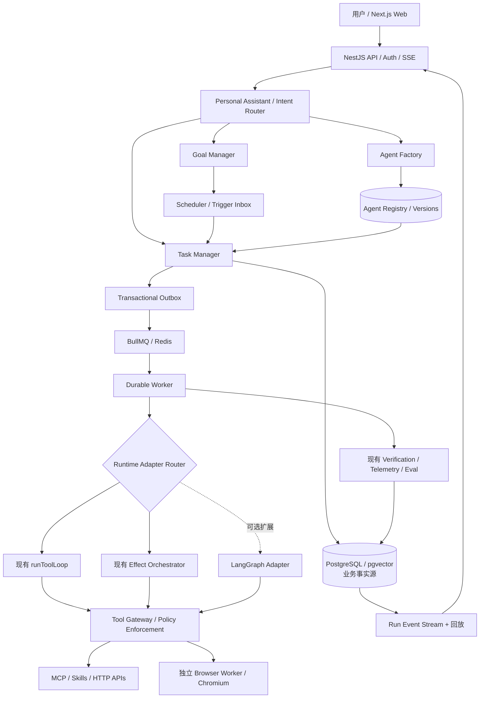
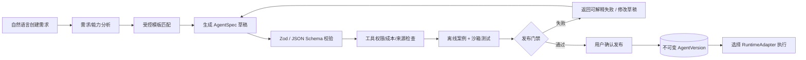
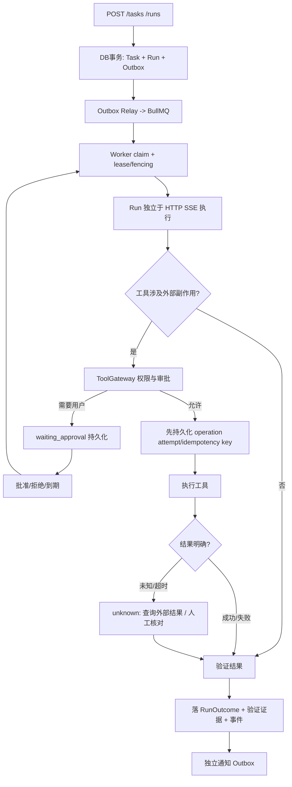
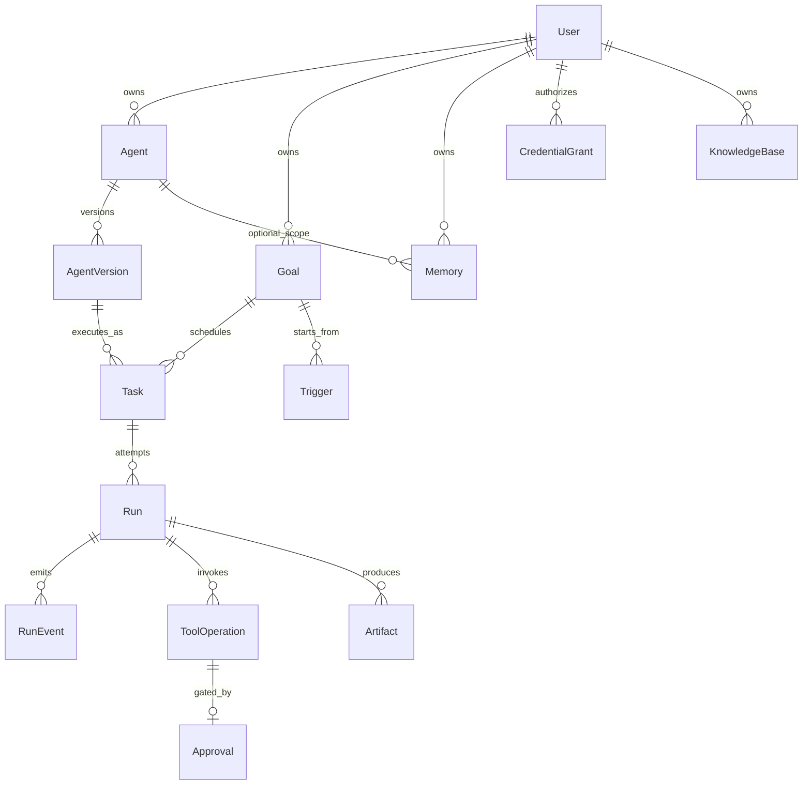

# Personal Agent 目标技术架构与现有代码复用矩阵

> 状态：**设计稿，尚未实现**。基线：`zrayjay/ai-agent-blog` 的 `main/agent-app`，核查 2026-10-26。这里“已有”仅表示仓库存在相关代码，不代表已经达到产品级持久可靠性。正式阶段与验收以 [02-ROADMAP](./02-ROADMAP.md) 为准。

## 1. 架构原则

- **产品与内核解耦**：业务层管理 User/Agent/Goal/Task/Run/Approval；Engine 只接收 `ExecutionContext` 与工具能力。API 不把用户请求直接绑到 HTTP 连接生命周期。
- **事实主存储与调度分离**：PostgreSQL 保存业务状态、版本及审批，Redis/BullMQ 管投递与租约；通知与执行业务副作用不互相触发重跑。
- **唯一执行主控**：一次 Run 只能选择一个 RuntimeAdapter（LegacyLoop / EffectOrchestrator / 未来 LangGraph）；跨 Runtime 协作通过 Task/Run API 而不是嵌套无限循环。
- **安全代理在模型之外**：授权、审批、能力租约、额度、幂等和审计全部由服务端 Tool Gateway 强制执行。
- **AgentSpec 版本不可变**：发布后新版本独立记录，正在运行的 Run 锁定 agentVersionId。
- **人可以随时介入**：暂停、取消、审批和浏览器接管都有受控状态迁移和过期检查。

## 2. 平台结构



**特别说明**：SSE 是观察通道不是 Run 的 owner；断线后 Run 继续，重新订阅按 event sequence 补偿。执行取消必须通过已鉴权的 API 显式发起。

**队列与并发是架构组成部分**：上图 BullMQ 是投递基础设施，不等于业务调度器。Task/Wake/Approval/Tool/Trigger/Notification 六类逻辑 lane、同会话互斥、审批期间持久会话恢复权、租约 fencing 与事故恢复见 [03-QUEUE-SCHEDULING.md](./03-QUEUE-SCHEDULING.md)；[04-SCENARIO-MATRIX.md](./04-SCENARIO-MATRIX.md) 为覆盖创建、执行、消息介入、资源竞争、故障与恢复的 54 场景验收基线。

## 3. 代码复用清单

| 现有路径（均位于 agent-app） | 当前职责 | 决策 | 主要改造 |
| --- | --- | --- | --- |
| `packages/engine/src/agent-loop.ts` | AI SDK 手写 Tool Loop / Abort / 回调 | **复用** | RuntimeAdapter 接口；执行边界注入 policy / durable events |
| `packages/engine/src/orchestrator/` | Effect 多 Agent 状态机、任务 DAG、策略 | **复用+改造** | `StateStore` 持久化、幂等恢复、取消传播、租约 fencing |
| `packages/engine/src/memory/` | Session / Preference / Episodic | **复用+扩展** | userId、agentId、scope、版本、授权、删除、长期会话持久化 |
| `packages/engine/src/rag/` | Ingest / Retrieval / pgvector | **复用+扩展** | 知识库所属者、ACL、来源、删除传播、批量重建索引 |
| `packages/engine/src/mcp/` | stdio MCP 适配 | **复用+改造** | 管理员允许的远端 Streamable HTTP、凭据隔离、schema 验证 |
| `packages/engine/src/tools/` | 工具组装、幂等、Registry | **复用+重构边界** | ToolGateway/CapabilitySpec、工具名冲突拒绝、外部副作用状态 |
| `packages/engine/src/skills/` | Skills Registry/Loader | **复用** | AgentSpec 按需启用、版本和来源可信度 |
| `packages/engine/src/guardrails/` | 输入/输出闸、确认、PII | **复用+加固** | 生产默认策略与 server-side 执行边界统一；不允许默认全关 |
| `packages/engine/src/verification/` | Run Outcome / Verifiers | **复用** | 持久化证据、状态与业务结果区分 |
| `packages/engine/src/evals/` | Eval/Quality Gate/Experiments | **复用** | Agent 发布验证、版本回归、成本门禁 |
| `packages/engine/src/telemetry/` | 结构化执行事件 | **复用+接线** | durable RunEvent、sequence、订阅回放、脱敏 |
| `apps/api/src/chat/` | 同步请求/SSE/短期审批 | **保留兼容** | 新增 Job API；现有 stream 不等于后台 Run |
| `apps/api/src/kb/`, `service/`, `team/` | 教学产品接口 | **保留** | 明确权限与业务模块分层 |
| `apps/web` | Next.js chat/kb/service UI | **保留扩展** | Agents、Goals、Tasks、Runs、Approvals、Browser 工作台 |
| `packages/shared` | Web/API DTO & events | **复用扩展** | Versioned contracts；RunEvent 与 legacy ChatStreamEvent 不混用 |

原工程教学型 `ToolRegistry` 同名覆盖，以及仅以 `s_`/`cs_` 前缀隔离会话，均**不能直接作为多用户授权隔离实现**。

## 4. 用户创建 Agent（Factory）



**AgentSpec v1 必要字段**：`schemaVersion`、`id`、`ownerId`、`name`、`purpose`、`modelPolicy`、`promptTemplate`、`runtimeKind`、`toolCapabilities[]`、`memoryPolicy`、`knowledgeScopes[]`、`approvalPolicy`、`budgets`、`evalSuiteId`。定时器/长期目标与 AgentSpec 关联，但实际调度实体独立存在。模型**不能**提交任意系统命令、MCP URL、访问令牌或代码作为已获信任的 Agent 配置。

版本生命周期：`draft → validating → testing → ready → published → deprecated/disabled`。失败版本保留错误与测试结果；历史 Run 保持原版本和工具快照，回滚只影响新 Run。

## 5. Durable Task 与 Run 协议



最小状态：Task `queued/running/waiting_approval/waiting_user/paused/succeeded/failed/cancelled`；Run `queued/claiming/running/waiting_approval/waiting_user/paused/succeeded/failed/cancelled/timed_out/unknown`。**RunStatus 不与现有 Effect 子任务状态强行合并**；提供映射。状态迁移使用 DB 乐观版本/CAS；`worker_id + lease_epoch` 防旧执行者覆盖。审批需绑定 `operationId + toolName + argumentsHash + agentVersionId + expiresAt`，拒绝后不得以旧批准重试；重启时 unknown 不自动再次发起支付、发信或外部写入。

**运行互斥必须拆为三层**：跨 waiting_approval/paused 保留 conversation reservation、短时 run execution lease、具体浏览器/文件 resource lease。等待审批可以释放计算资源但不能让另一个 Run 偷偷续写同一会话，见 [场景矩阵 §A2](./04-SCENARIO-MATRIX.md#a2-三层所有权锁模型)。

## 6. 数据实体 / 数据库

建议新增 Prisma 迁移，PostgreSQL 为事实源；现有 pgvector 表先兼容，避免无必要重建嵌入：



核心业务表：`users`, `agents`, `agent_versions`, `goals`, `triggers`, `tasks`, `runs`, `run_events`, `tool_operations`, `approvals`, `memories`, `knowledge_bases`, `credential_grants`, `artifacts`, `outbox_events`。**队列增量表**：`conversations`, `conversation_inbox`, `run_attempts`, `execution_leases`, `resource_leases`, `trigger_occurrences`, `notification_deliveries`，用途与唯一约束详见场景矩阵。索引必须覆盖 `(owner_id, id)`、`(run_id, seq)`、`(status, next_run_at)`，工具操作按可用外部幂等键做唯一约束。具体 Prisma DDL 在 P1/P2 PR 中实现并检验迁移与回滚，不能先宣称已经存在。

## 7. 模块与目录增量规划

```text
agent-app/
├── apps/
│   ├── api/src/
│   │   ├── auth/ users/ agents/ goals/ tasks/ runs/
│   │   ├── approvals/ integrations/ memories/
│   │   └── chat/ kb/ service/ team/          # 保留历史
│   ├── worker/                               # 新增 Durable Worker
│   ├── browser-worker/                       # P4 独立隔离执行
│   ├── web/app/(app)/agents/ goals/ tasks/ runs/ approvals/
│   └── cli/                                 # 保留
├── packages/
│   ├── engine/                               # 复用现有 Engine
│   ├── shared/                               # 版本化 DTO 和事件
│   ├── runtime/                              # RuntimeAdapter/ExecutionContext
│   ├── agent-factory/                        # Spec/模板/验证/发布
│   ├── policy/                               # ToolGateway/ACL/审批策略
│   └── db/                                   # Prisma schema/迁移/Repository
└── docs/personal-agent/
```

在实现中允许合并包，先守住**依赖方向**：UI → API/共享契约；API/Worker → 应用服务 → Engine/Runtime；Engine 不反向 import NestJS/Prisma/前端。切勿为目录形式提前制造循环依赖。

## 8. API 与事件最小契约

- `POST /api/agents/drafts`、`POST /api/agents/:id/validate`、`POST /api/agents/:id/publish`、`GET /api/agents`
- `POST /api/tasks`、`POST /api/tasks/:id/runs`、`GET /api/runs/:id`、`POST /api/runs/:id/pause|resume|cancel`
- `GET /api/runs/:id/events?after=<seq>`（SSE；附鉴权、重连回放与流结束条件）
- `POST /api/approvals/:id/decide`（需操作者身份、审批版本及有限期）
- `POST /api/goals`、`POST /api/triggers`（P6）

所有响应与事件必须返回资源所属用户可见的字段，密钥不经 API 返回；`run_events` 包括 `runId`、`seq`、`eventId`、`type`、`timestamp`、`redactedPayload`，并支持幂等去重。

## 9. 非功能要求

- **恢复**：任务恢复 ≠ 重放外部业务；重启后先核对工具操作回执，不能在网络超时时盲目执行第二次。
- **安全**：凭据密文存储及运行时注入；沙箱限制文件、进程、网络；浏览器和模型不应直接接触长效密钥。
- **运行成本**：记录每次模型/工具实际使用量；来源不返回 token 时标记 unknown，不能虚构 0。
- **评价**：复用 Eval/Verification/Quality Gate；Agent 发布必须有至少一组风险与功能案例，CI 不得把 skipped 视为 passed。
- **存储**：session Redis TTL 不是可审计历史存储，必要会话、成果和 Run 事件在 PostgreSQL/对象文件存储中持久化。
- **多用户**：所有 DB 查询、工具调用、MCP 凭据必须按 userId/agentId 授权，不能只靠会话 ID 前缀隔离。

## 10. ADR（待决策，不阻塞 P0）

| 编号 | 决议 | 后续复议条件 |
| --- | --- | --- |
| ADR-01 | 保留 Next.js、NestJS、AI SDK、Effect 引擎 | 产品约束或评测证明无法满足 |
| ADR-02 | LangGraph 可选接入，不默认替代已有 Loop | P7 复杂 checkpoint/subgraph 需求 |
| ADR-03 | 业务状态 PostgreSQL、任务 BullMQ | 多区域/高吞吐实测需要 |
| ADR-04 | P3 使用受控 AgentSpec，禁止自动执行新生成源码 | 真正有隔离代码沙箱及安全验证 |
| ADR-05 | 单用户自托管优先，模型设计显式 ownerId | 经过权限模型测试后开放多用户 |
