# Personal Agent — 分阶段实施总计划 V3（场景驱动）

> **状态：设计方案，尚未开始实施。最后重构：2026-10-26。**
>
> 代码基线：仓库 `agent-app` 当前实现；不是从零新建项目。对应 [产品入口](./README.md)、[目标架构与复用矩阵](./01-ARCHITECTURE.md)、[队列与调度规范](./03-QUEUE-SCHEDULING.md)、[54 个场景及不变量](./04-SCENARIO-MATRIX.md)、[评估架构与 Evaluator Agent](./05-EVALUATION-ARCHITECTURE.md)。旧 `README/ARCHITECTURE/BACKLOG` 仍是教学项目现状记录；本文是 **Personal Agent 产品开发的唯一实施总计划**。

## 0. 产品目标、关键决策与阶段出口

### 0.1 产品目标

参考 Muse、Dots 等 Personal Agent 的产品方向，建设一个能够**跨会话记忆、允许用户创建 Agent、后台执行、受控操作外部系统、持续跟进目标并在合适时间主动通知**的个人智能平台。仅借鉴公开能力，不推断其未公开实现。

首版是**单用户自托管、架构具备多用户隔离能力**的产品，不是全自动付款机器人，也不要求每个 Agent 都有独立进程或专属 Redis Queue。

### 0.2 不可改变的复用决策

- 保留 `apps/api` NestJS、`apps/web` Next.js、`apps/cli`、`packages/engine`、`packages/shared` 和 pnpm/Turborepo；不重复搭建一个 Vite 前端。
- 优先复用 `agent-loop.ts`（AI SDK）、Effect `orchestrator`、Memory/RAG、MCP、Skills、Guardrails、Telemetry、Verification、Eval/Quality Gate、**Experimentation 与 Failure Candidate 审核**；新增 Evaluator Agent 是独立评估/诊断角色，不拥有修改质量门禁或生产权限的能力。
- 保留旧 `chat/kb/service/team` API/CLI 可用；把“请求断开即停止”的即时聊天与“Web 断线继续”的后台 Task/Run 拆开，**不互相偷偷改变原语义**。
- 在现有 Runtime 外增加 RuntimeAdapter；LangGraph.js 是 **P7 按需验证再引入**的备选，而不是 P0–P2 的硬依赖。
- **PostgreSQL 是业务事实源；BullMQ/Redis 是至少一次投递通道；AgentScheduler 是业务仲裁者。** 不为每个 Agent/用户建一个物理 Redis Queue。
- Agent Factory 首版生成**受控的 AgentSpec 和不可变 AgentVersion**，不直接执行模型生成的任意 TypeScript 代码。
- 一切执行与权限遵守场景规范的 **I01–I12 十二条不变量**，包括会话预约、执行租约、资源租约分离、外部副作用 unknown 不盲重试、取消与恢复可审计。

### 0.3 阶段依赖与发布里程碑

```mermaid
flowchart LR
  P0["P0 现状审计/回归基线"] --> P1["P1 身份/持久化契约"]
  P1 --> P2A["P2-A Task/Worker"]
  P2A --> P2B["P2-B Wake/Approval"]
  P2B --> P2C["P2-C 故障恢复与队列 UI"]
  P2C --> M1(["M1 后台任务 MVP"])
  M1 --> P3["P3 Agent Factory"]
  P3 --> M2(["M2 自建 Agent"])
  M2 --> P4["P4 Tool/MCP/Browser"]
  P4 --> P5["P5 长期记忆/RAG"]
  P5 --> M3(["M3 受控行动与记忆"])
  M3 --> P6["P6 Goals/Triggers/Notifications"]
  P6 --> P7["P7 多 Agent/长期可靠性"]
  P7 --> M4(["M4 Personal Agent Beta"])
```

| 里程碑 | 包含 | 对用户的真实交付 | 不应宣称 |
| --- | --- | --- | --- |
| M0 | P0–P1 | 现有教学功能稳定、账户/业务基础与隔离契约就绪 | 已有可靠后台 Agent |
| **M1** | P2-A/B/C | 任务后台运行、消息排队、审批挂起与恢复、队列可见 | 任意外部写操作 exactly-once |
| **M2** | P3 | 用户能自然语言创建、测试、发布并运行自己的专业 Agent | 已有长期自主目标和浏览器全部能力 |
| **M3** | P4–P5 | 受控 MCP/浏览器操作、记忆与知识范围隔离 | 未授权第三方平台已经接通 |
| **M4** | P6–P7 | 长期目标、触发/通知、多 Agent 委派、评测与运维 | 无测试证明的无限自主执行 |

**硬性顺序**：M1 未通过不能宣称 Agent Factory 达到可用；P4 与 P5 的设计可以并行，实施时以共同的 IAM/ToolGateway/AgentVersion 为依赖。

## 1. 六条队列贯穿哪些开发阶段？

> 队列是**业务逻辑 lane**，不对应六个必建 BullMQ 队列。实现遵守 [03-QUEUE-SCHEDULING](./03-QUEUE-SCHEDULING.md)。

| 逻辑 Lane | 什么时候做 | 持久化事实 | 业务规则 |
| --- | --- | --- | --- |
| **Task Queue** | **P2-A** | Task/Run/Attempt/Outbox | 会话串行、Agent 按 owner 配额并发、优先级与依赖 |
| **Wake / Inbox Queue** | **P2-B** | Conversation/InboxMessage/seq | 忙碌时 pending，steering 需 ACK，否则 continuation |
| **Approval Queue** | **P2-B** | ToolOperation/Approval | 等待不占 Worker；保留会话恢复权，批准绑定操作和参数 |
| **Tool / Resource Queue** | **P4** | ToolOperation/ResourceLease | profile/文件资源独占、浏览器人工接管和回执核验 |
| **Trigger Queue** | **P6** | Goal/TriggerOccurrence | cron/webhook 触发去重、重叠与错过触发策略 |
| **Notification Queue** | **P6**（P2 先留出事件出口） | NotificationDelivery | 通知失败单独重试，不重跑 Task |

**三重所有权，不得混淆**：`conversation reservation`（等待审批时保留续写权）、`run execution lease`（Worker 短期执行权）、`resource lease`（浏览器/文件资源独占权）。相同 conversation 串行，**不等于**整个用户所有 Agent 都串行。

## 2. P0 — 审计、契约和不可破坏的回归基线

**前置**：无。**目标**：确定现有资产的真实状态，建立后续开发不会破坏原产品线的基线。

### 开发批次

- **P0.1 代码证据**：固定当前 main SHA、Node/pnpm/lockfile、工作区结构；逐项定位 `runToolLoop`、`Effect orchestrator`、`MemoryStateStore`、`Telemetry`、`Verification`、`Guardrails`、`MCP` 的调用链及状态存储位置。
- **P0.2 回归测试**：实际记录 `pnpm build`、`typecheck`、`test:engine`、`test:api`、`selftest`、`eval`、`quality-gate`；真模型/数据库缺失造成 skipped 必须记为未验证，不能记成功。
- **P0.3 契约与状态图**：冻结 Task、Run、RunAttempt、ConversationInbox、Approval、ToolOperation、TriggerOccurrence、NotificationDelivery 的 ownerId、状态和版本；区分现有 Effect 子任务状态与平台 RunStatus。
- **P0.4 场景追踪**：54 个 SC 编号与评估 E01–E12 进入测试计划；建立故障注入 fixture 和每条需求到测试的追踪表；ADR 记录“何时需要 LangGraph”。
- **P0.6 评估复用审计**：对照现有 `evals/`, `verification/`, `quality-gate`, `experiments`, `failure-cases` 已实现能力建立覆盖矩阵，记录 safety/reliability 正式评分套件、业务运行证据输入与发布门禁接线缺口；不要误以为需要从零造 Eval。
- **P0.5 CI**：确保 engine/API/CLI 确定性测试被真正执行；已有质量门禁继续保留，不以跳过套件伪装通过。

**建议 PR**：`docs/p0-baseline-and-adr`、`test/p0-regression-gates`。

**退出门禁**：旧 chat/kb/service/team/CLI 无行为回归；有真实测试报告、依赖/风险清单、P1 迁移计划。**此阶段不改 Agent 算法，不新建 Agent Factory。**

## 3. P1 — 平台身份、Schema、权限与业务事实源

**前置**：P0。**目标**：为后续可靠队列和 Agent Factory 建立可迁移、可鉴权的数据合同。

### 开发批次

- **P1.1 数据库**：新增 `packages/db`（Prisma + PostgreSQL migration）；核心表 `users/agents/agent_versions/conversations/conversation_inbox/tasks/runs/run_attempts/run_events/outbox_events/execution_leases/tool_operations/approvals`。Tool/Goal/通知专用表可在本期定义契约，P4/P6 迁移实施。
- **P1.2 身份/资源权限**：NestJS Auth（安全密码哈希、登录会话）、ownerId + agentId 的 DB/service 层作用域校验，禁用仅靠 `s_`/`cs_` 前缀作为安全边界；单用户部署也不跳过 ACL。
- **P1.3 状态机**：会话预约权与执行租约拆成独立实体；租约 `epoch` 单调、CAS/唯一 active scope；审批以 operationId + argsHash + actor + expiresAt 绑定。
- **P1.6 Evaluation 契约**：定义 `EvaluationJob/EvaluationReport/ReviewDecision` 的 API DTO 与 owner/agentVersion/run 关联字段；独立评估逻辑 lane 可以沿用现有受控 Worker，不要求立即增加物理 Redis Queue。
- **P1.4 API 契约**：`packages/shared` 添加版本化 Task/Run/Inbox/QueueEvent DTO，不改变既有 `ChatStreamEvent` 的线上形状；规范客户端 requestId 和幂等响应。
- **P1.5 Web 壳**：在 Next.js 保留 chat/kb/service 页面，新增 Tasks/Runs/Agents/Approvals 导航及空状态；禁止页面直连 Redis 或展示密钥。

**建议 PR**：`feat/p1-db-contracts`、`feat/p1-auth-acl`、`feat/p1-platform-web-shell`、`test/p1-migrations-and-permissions`。

**退出门禁**：迁移及回滚通过；两身份越权访问、并发 claim/epoch 竞争有确定性及 PG 集成测试；旧接口仍可用。**已有表是 schema，不代表已有持久后台执行。**

## 4. P2 — 持久后台执行、队列与恢复（M1 必过）

> **本阶段必须拆成 A/B/C 三个发布门禁。** 这里是 Personal Agent 能否脱离浏览器持续工作的关键阶段，不能简单以“BullMQ 已接通”验收。

### P2-A：Task Queue / Worker / Outbox

- 建 `apps/worker`，BullMQ 只承载有限数量的物理队列，如 `agent-runs`；用 `TaskService`、`RunService`、`AgentScheduler`、`OutboxRelay` 调度任务。
- **原子入口**：用户提交任务时 Task/Run/Outbox 在同一 PG transaction，commit 后返回 accepted；Redis 不可用时可保留 durable pending（或背压失败，行为明示）。
- **原子 claim**：Scheduler 检查 owner 总并发、同 conversation active reservation、任务优先级/依赖/预算；执行租约 epoch + CAS，旧 Worker 不得覆写状态。
- **Runtime 复用**：第一版 `LegacyLoopRuntimeAdapter` 使用现有 `runToolLoop`。执行上下文包含 owner、agent version、runId、cancelSignal、allowedCapabilities、budget。
- **评估证据接线**：运行时写入受控 `ToolOperation` 回执、RunOutcome、VerificationResult、Trace；业务执行结束后以 Outbox 触发异步评估，不重新执行原任务外部工具。
- **后台语义**：`POST /api/tasks` 创建后台 Run；`GET /api/runs/:id/events?after=<seq>` 按 RunEvent 回放。原 `GET /api/chat/stream` 断线中止行为不变，不能把此接口假装后台任务。
- **预算**：达到 token/时间额度进入可解释终态或等待额度状态；任务必须有限重试和执行次数。

**此批验收**：SC01、SC04、SC09–SC18、SC35、SC37–SC40、SC54（不涉及第三方真实副作用的部分）。必须至少有真实 PG+Redis+双 Worker 的并发/重复派发/kill 后恢复测试。

### P2-B：Wake Queue / Approval Queue / Cancellation

- **WakeInbox**：每条用户输入（含原始内容/附件引用）单独持久化、会话递增 seq；可合并 wake signal，**绝不合并丢弃输入**。不要求 `@agent` 唤醒前缀。
- **Busy 语义**：同会话已运行则 Inbox=pending/deferred；仅现有 Runtime 有安全边界和确认 ACK 时允许 steering，否则当前 Run 结束后 continuation。**不要为了“即时响应”启动第二个同会话 Run**。
- **审批**：持久化 `Approval`、`ToolOperation`。waiting_approval 时释放计算执行租约、保留 conversation reservation；approve/deny/expire 经 PostgreSQL CAS，恢复时复核授权、工具与参数。
- **取消/暂停**：写入持久 intent，AbortSignal 传播到模型/工具安全边界；取消与完成竞争以 CAS 和工具真实回执收敛；取消不能撤销已生效的支付/邮件。
- **会话改变**：新输入修改待执行外部动作时，使受影响的旧 Approval 失效并要求重新审查。
- **长期等待**：审批、需要用户补信息和人工核对均不持有 Worker 执行槽；Run 保存恢复信息或标注 requires_review，不能假装精确 checkpoint。

**此批验收**：SC02–SC08、SC20–SC21、SC23–SC26、SC32–SC34、SC36。测试 20 条短时间消息、编辑/撤回、重复审批、审批参数变更、未知写入结果、取消/完成竞态。

### P2-C：自动恢复、调度可观测、故障门禁

- **Reconciler**：恢复时扫描未完结 Run/Outbox/Lease/ToolOperation；对允许安全续跑的状态自动恢复；外部写操作未知时停下核对，**不得凭 BullMQ 重试自动二次写入**。
- **三类状态源**：PG 业务 Task/Run 状态、BullMQ 传输状态、RunEvent 观察状态严格分离；DB 是用户可见状态真相。
- **Dashboard**：队列 backlog、最老 pending 时间、owner 运行配额、Wake pending/applied、审批倒计时、unknown 待核对、每个 Run 执行和事件历史。
- **恢复测试**：Kill Worker、Relay、Redis 网络中断、PG 短暂不可用、旧 Worker lease 到期回归、重复投递、客户端断线；测试计数/日志必须能证明没有重复外部副作用。
- **可靠性 SLO（先定义、后按压测校准）**：队列积压 age、Run 成功/超时率、租约过期率、审批滞留、Outbox backlog、unknown 操作数、通知另计。
- **安全基线**：ToolGateway 最低权限校验从 P2 进入 Worker 工具出口，P4 才扩充浏览器/远端 MCP；现有 guard env“默认全关”不能直接作为产品安全默认。

**此批验收**：SC10、SC13–SC18、SC21、SC32–SC40 与场景矩阵 P2 指定故障。建立矩阵执行证据（测试 ID、环境、结果、未验证部分）；Q01–Q14 对应阶段条目必须可追踪。

**M1 发布门禁（缺一不可）**：关闭浏览器仍执行；重新连接事件按 seq 回放；同会话只一个续写者；两个无资源冲突 Agent 可以按配额并发；20 条输入完整不乱序；审批等待不占 Worker 但保留会话预约权；重复 Bull job 无重复业务执行；非幂等外部操作 unknown 不自动重放；DB/Redis 重启有可靠恢复或明确人工待处理结果。

建议 PR 顺序：`feat/p2-outbox-task-queue` → `feat/p2-worker-run-leases` → `feat/p2-wake-inbox` → `feat/p2-approval-resume` → `feat/p2-sse-queue-dashboard` → `test/p2-failure-matrix`。

## 5. P3 — Agent Factory：用户自己创建自己的 Agent（M2）

**前置**：M1。**目标**：将 Personal Agent 从一个通用助手扩展为**可管理、可发布、可评估的专业 Agent 工厂**。

### 开发批次

- **P3.1 AgentSpec 与模板**：Zod JSON Schema（purpose/systemPrompt/modelPolicy/tools/capabilities/memoryScope/evalSuite/budget/approvalPolicy/runtimeKind）；Research、Knowledge、General、Coding 模板；不允许未经审查的生成代码自动运行。
- **P3.2 Factory 作为持久任务**：自然语言创建 → 分析能力 → 模板匹配 → 生成 Draft → schema/策略检查 → 沙箱测试 → Eval/Quality Gate → 用户发布；每个阶段保留事件和失败证据。
- **P3.6 质量发布门禁**：复用现有 `quality-gate.ts` 和 `evals` + `verification` 数据，为每个 AgentVersion 建领域 Golden Dataset、rubric 与风险级关键用例；必查项缺席返回 inconclusive，不得默认发布。支持受限 Evaluator Agent V1 做问题归因/改进建议，用户审批后才发布。增加 E01–E03、E10–E12 场景验收。
- **P3.3 Registry/Version**：`Agent` 和不可变 `AgentVersion`、published 指针、disable/rollback；**运行中的 Run 固定 version**，但凭据撤销和全局安全禁令必须实时生效。
- **P3.4 Tool/Skill 授权**：用户显式选择已登记工具，按 agentVersion 生成 capability snapshot；不能通过 Prompt 或 Tool 名称自授予权限。
- **P3.5 Factory UI**：草稿、权限审批、测试报告、发布、版本历史、Agent 任务历史；浏览器关闭 Factory Job 仍可继续或暂停。

**场景验收**：SC48–SC50。两个 Agent 并发创建无覆盖；失败 Agent 不自动发布；模型生成 Spec 不可越权；已有 Run 不因版本切换而偷偷改变行为。

**建议 PR**：`feat/p3-agent-spec-registry`、`feat/p3-factory-pipeline`、`feat/p3-factory-evals`、`feat/p3-agent-ui`、`test/p3-factory-scenarios`。

## 6. P4 — Tool Gateway、MCP 与 Browser Resource Queue

**前置**：M2 的 AgentSpec/Capability 和 M1 的 ToolOperation/Approval。**目标**：Agent 在外部系统中**被授权地行动**。

- **P4.7 真实操作评估**：新增 Tool/Browser 的外部回执、注入/越权和副作用 unknown 验证，接 Eval/Verification；覆盖 E04–E09 风险场景。
- **P4.1 Gateway**：MCP 与原生工具统一 schema validation、能力许可、参数审查、审批、幂等尝试、审计和错误分层。旧 Registry 同名静默覆盖必须在产品层拒绝。
- **P4.2 MCP 管理**：沿用已有 stdio 适配，增加受控 Streamable HTTP，连接凭据租户隔离；SSRFi/网络出口白名单/远端 schema 变化测试。不能把任意用户填的服务地址直接当可信工具。
- **P4.3 Browser Worker**：独立 Playwright/Chromium、隔离 profile 与受限网络/文件系统；支持读取、导航、操作、截图、下载。
- **P4.4 Resource Queue**：同 browserProfile/file workspace 独占 writer；人工接管前 Agent 必须在安全边界交权，交回后重新获取页面状态。
- **P4.5 可验证外部副作用**：高风险写动作审查与 operation receipt；站点页面已提交但超时时 unknown + reconciliation/人工，不能盲点第二次。
- **P4.6 首批能力**：搜索/网页只读、GitHub 只读、文档摘要优先；真实邮件发送、付款、删库等在明确权限与回执机制之前不开放自动写。

**场景验收**：SC22、SC27–SC31；浏览器同 profile 双 Agent 并发、人工接管、网页注入和远端 MCP schema 漂移的 E2E/故障测试。**不得宣称未联调的第三方连接器可用。**

## 7. P5 — 长期记忆、RAG 和个人数据隔离

**前置**：P1 ACL、P3 AgentVersion；可和 P4 的非冲突模块并行。

- 复用 Session/Preference/Episodic + pgvector/RAG，但明确 `user / agent / goal / conversation` 四级 scope 与共享授权。
- Redis 24h session window 只负责短期上下文；用户可读的历史记录和记忆 provenance 单独持久化，跨会话检索需权控。
- 记忆写入采取“候选、来源、纠错、删除、重建索引”的流程；不允许网页/文档嵌入的 Prompt Injection 成为系统记忆指令。
- 知识库增加 owner ACL、source/文档版本、删除传播、增量导入失败恢复和敏感信息检测。
- 为检索增加 groundedness、引用忠实性与跨 Agent 记忆隔离 Eval，不用 Recall@k 单项代替完整回答质量。
- 验收跨 Agent 私有/共享记忆、删除后不能再召回、跨用户访问拒绝；Eval 要有正反案例。

**场景验收**：SC51，外加附件/授权/删除专项测试；不能将“模型记住了”当持久化测试证据。

## 8. P6 — Goal Manager、Trigger Queue、主动通知

**前置**：M1 的持久调度/状态能力、M2 的 AgentVersion；推荐在 P5 后交付。

- Goal/Plan/Trigger/TriggerOccurrence/nextRunAt，存 IANA timezone，定义 DST 与错过执行（misfire）策略。
- Planner/Replanner 生成结构化可追踪计划；Plan 不等于直接执行，外部写操作依旧经过 ToolGateway/Approval。
- Trigger 逻辑 lane：cron、间隔、外部 webhook/event 都先去重再创建 Task/Run；同 Goal 重叠策略 `QUEUE/SKIP/COALESCE/REPLACE` 必须可配置。
- Notification 逻辑 lane：各发送渠道 `NotificationDelivery` / attempts / receipt，和业务 Run 彻底解耦；通知失败不重新执行任务。
- 长期目标 UI：计划、触发记录、跳过原因、下一次运行时间、审批待办、执行摘要和费用。
- **默认安全策略**：主动轮询/通知遵从频率、预算、撤权、敏感性限制；订阅源不可信指令只当外部数据。
- **持续质量评估**：Goal 触发记录、实际成果和通知回执关联 EvaluationJob，区分“按时触发”“任务完成”和“真正达到用户目标”。

**场景验收**：SC41–SC47。重启/多副本 cron 去重、停机错过多次后的限量补跑、DST、通知 unknown 与渠道失败测试。

## 9. P7 — 多 Agent 编排、可选 LangGraph、可靠性产品化

**前置**：M1–M3，Goal 可与此阶段局部并行。

- 先复用现有 Effect Orchestrator 的 DAG、子任务验收、失败重试/降级/补偿/升级人工；将 `MemoryStateStore` 换为持久 StateStore 并增加父子 Run 关系。
- Supervisor 基于 Agent Registry 的 capability 匹配选择子 Agent，**不是把全部用户创建的 Agent 逐个唤醒**。
- 子 Agent 继承权限交集，父任务预算和并发总账，支持取消传播、子任务部分成功和失败解释；同会话与共享资源仍遵守 Scheduler 锁规则。
- 仅在证明现有 Effect/Loop 的中断、复杂子图需求确实不够时，以 RuntimeAdapter 验证 LangGraph.js；不得让一次 Run 同时受双 Agent Loop 主控。
- 加固：按 owner 公平性与负载背压、Provider rate-limit、模型 fallback 策略、安全红队、恢复演练、备份恢复、Secrets 轮换、OpenTelemetry/Trace/成本、Eval 基线门禁。
- **评估运营平台**：复用 `experiments.ts` 的配置对照、重复实验与失败候选；按 AgentVersion 长期跟踪质量回归、Judge 误判校准和成本；验证不可信网页/用户数据不会自动修改 Golden Dataset 或基线。在线评估异步采样，绝不让它拥有业务工具执行权。
- Beta 运营指标：成功/失败/需要人工分布、P50/P95 延迟、队列 oldest pending、unknown 工具操作、pending approvals、通知送达、成本以及用户纠错率；没有真实数据的维度标 unknown。

**场景验收**：SC19、SC52–SC53 + 场景矩阵的跨 Agent/拥塞/越权专项；多 Agent 协同过程部分失败仍可解释，运行成本和所有副作用可追踪。

## 10. 场景到阶段、测试与 PR 的追踪表

| 范围 | 主要阶段 | 最低验收关注 |
| --- | --- | --- |
| SC01–SC10 | P2（基础 ACL 在 P1） | 新消息、繁忙唤醒、20 条连续输入、幂等、取消、会话隔离 |
| SC11–SC18 | P2 | 并发限额、排序、公平基本策略、Redis 重投、PG 状态收敛 |
| SC19 | P7 | 多 owner 加权公平和负载背压 |
| SC20–SC21 | P2 | 只读重试安全、外部写超时 unknown |
| SC22 | P4 | 真实高危操作防线、审批结果与回执 |
| SC23–SC26 | P2 | wait 不占 Worker、重复批准、过期/参数变化拒绝 |
| SC27–SC31 | P4 | 提示注入、MCP schema、浏览器竞争和人工接管 |
| SC32–SC40 | P2 | 取消/完成竞争、双 Worker lease、PG/Redis/Outbox 故障恢复 |
| SC41–SC47 | P6 | 定时触发、重叠、DST、misfire、通知隔离 |
| SC48–SC50 | P3 | Factory 草稿、并行创建、版本快照和发布门禁 |
| SC51 | P5 | 私有/共享记忆 ACL 和删除 |
| SC52–SC53 | P7 | 子 Agent 权限、DAG 失败补偿及验收 |
| SC54 | P2 基础 / P7 优化 | 预算硬阻断、成本可观测、跨子任务额度 |

场景矩阵额外的文件/附件、凭据撤销、Agent 删除、隐私删除、队列饥饿五项专题，按对应模块阶段实施并记录测试编号。

## 11. Agent Evaluation 跨阶段验收门禁

[05-EVALUATION-ARCHITECTURE.md](./05-EVALUATION-ARCHITECTURE.md) 为规范性文件。**E01–E12** 作为独立评估场景编号，不能拿 SC01–SC54 的任务/队列测试代替。P3 Agent 发布必须具备可解释的 EvaluationReport、评估数据集版本、关键用例一票否决、人工审核、发布审批；运行中的评估必须以实际证据为准，`Run succeeded` 不直接等于 `Objective accepted`。P7 完成跨 Agent 的质量/成本和样本偏差回归。

## 12. OpenCode 工作约定：按门禁拆 PR

每个小 PR 采用相同交付结构，确保可审查和可回滚：

1. **范围**：写清目标、涉及哪一层、依赖哪个 ADR / SC 编号和明确非目标。
2. **契约**：TypeScript/Zod DTO、状态迁移、数据库唯一约束、事件 schema；不得只写 UI。
3. **实现**：以现有模块扩展为主；保持 package 层依赖方向，拒绝为了“看起来统一”重写 Engine。
4. **测试**：单元 + 真实 PG/Redis 集成（适用时）+ 故障注入 + 权限/安全案例；避免只使用成功路径 mock。
5. **迁移与回滚**：schema backward compatibility、配置安全默认值、数据修复脚本、失败兜底。
6. **证据**：明确通过/失败/skipped，关联 PR SHA、测试命令、样例日志及性能/费用变化。
7. **文档**：更新对应场景 SC 与 E 的状态（planned/implemented/tested/external-unverified），更新 README 和 API。
8. **门禁**：CI 若跳过关键质量测试，不得标记阶段完成；相同内容避免重复在五份文档维护。

建议将执行情况记录到 **`05-IMPLEMENTATION-STATUS.md`（待 P0 创建）**，与本 Roadmap 分离：Roadmap 负责计划，Status 只记录真实 PR/CI/验收证据。

## 13. 开发起点与禁止事项

**第一批给 OpenCode 的具体执行范围只有 P0**：固定基线、保留旧功能、测试门禁、冻结数据与队列契约；完成 P0 后才按 P1 → P2-A → P2-B → P2-C 推进。没有 M1 的队列/恢复验收，不要开始对外承诺“多 Agent 自主运行”。

**禁止事项**：

- 不得以 BullMQ job completed 代替业务 Run succeeded；不能假定分布式 exactly-once 外部副作用。
- 不得把 Wake Queue 等同于 Task Queue；合并 wake 信号不能覆盖用户消息正文。
- 不得等待审批时同时释放 **会话恢复权** 并允许另一个 Run 续写；只能释放执行槽。
- 不得因为页面刷新/断线取消后台 Run；即时 chat 接口原有语义另行保留。
- 不得静默绕开权限、接受模型生成的任意执行代码、提升子 Agent 权限或把未经授权的连接器写成已上线。
- 不得“处理好异常”却没有场景测试证据；真实第三方账号无法联调时必须标注 external-unverified。
