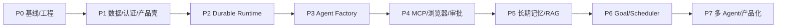

# Personal Agent P0–P7 分阶段实施与验收计划

> **执行依据**：[目标架构](./01-ARCHITECTURE.md)。以下均为**待实施计划**，非现有功能已通过的声明。每阶段必须把源码复用和兼容测试放在第一位，按小 PR 开发，禁止一次性重构所有模块。

## 总览

**队列设计强制依据**：[03-QUEUE-SCHEDULING.md](./03-QUEUE-SCHEDULING.md) + [04-SCENARIO-MATRIX.md](./04-SCENARIO-MATRIX.md)。所有功能 PR 必须标注适用 SC 编号，先验收 Task/Wake/Approval，再逐步扩展 Tool/Trigger/Notification。不能以 BullMQ 可运行代替调度可靠性。

**里程碑**：M1 = P0–P2（可靠后台任务）→ M2 = P3（用户可创建 Agent）→ M3 = P4–P5（可靠工具与记忆）→ M4 = P6–P7（持续目标和多 Agent）。各阶段依赖并非意味着所有 UI/测试完全串行：P4、P5 的基础契约可在 P3 期间并行设计。

## P0 基线冻结与复用审计（第一批）

目标：所有原功能可运行，防止后续改造成“重新做一个 Demo”。

**任务**
- [ ] P0-01 固定 main commit SHA、Node/pnpm 版本、依赖锁；记录实际 `pnpm build`、`pnpm typecheck`、`pnpm test:engine`、`pnpm test:api`、`pnpm selftest`、`pnpm eval`、`pnpm quality-gate` 结果；失败/跳过要如实记录。
- [ ] P0-02 整理 Agent Loop、Effect Orchestrator、StateStore、Tool Assembly、Run Contract、Memory、MCP 与 Guardrails 入口和当前责任界限；识别功能重复、版本不匹配、未覆盖测试。
- [ ] P0-03 扩充 CI：执行 engine/API/CLI 的确定性测试与依赖边界检查；需真 Key 的测试走独立受控门禁，不允许跳过被写为通过。
- [ ] P0-04 建立 ADR、迁移清单和变更保护测试；先不改执行算法，不搬动业务目录。
- [ ] P0-05 将 54 个场景编号纳入测试规划，冻结独立 Task/Run/Inbox/ToolOperation/Approval/Notification/Trigger 状态机、租约/会话保留权与运行配额默认策略。

**验收**：原 chat/kb/service/team + CLI 冒烟可复现；CI 无回归；产出清晰的 P1 差异列表。**不直接创建 Agent Factory。**

## P1 平台基础与数据契约

目标：从教学单会话服务升级到具备身份、持久业务实体的 API。

**任务**
- [ ] P1-01 新增 `packages/db` Prisma + PostgreSQL migration，覆盖 User、Agent、AgentVersion、Task、Run、Approval、RunEvent、Outbox 最小集；保留现有 pgvector 的库表兼容性。
- [ ] P1-02 NestJS Auth / User / AccessPolicy，单用户部署也强制 ownerId；密码哈希、登录会话安全、授权校验。
- [ ] P1-03 `packages/shared` 定义 versioned DTO、RunEvent；保留旧 ChatStreamEvent 兼容。
- [ ] P1-04 扩展 Next.js 布局：Agents、Tasks、Runs、Approvals 空状态页面，旧 chat/kb/service 保留。
- [ ] P1-05 编写数据库迁移、权限越权、创建与读写等测试。
- [ ] P1-06 新增 queue-scope/故障恢复表设计：`conversation_inbox`, `run_attempts`, `execution_leases`, `resource_leases`, `tool_operations`, `trigger_occurrences`, `notification_deliveries`，为事务 Outbox、去重、epoch fencing 和会话 reservation 建立约束。

**验收**：未登录请求被拒绝；越权返回拒绝；迁移前后旧数据可用；不通过单纯 sessionId 猜测访问别人的数据。

## P2 Durable Runtime（产品可用性门槛）

目标：关闭浏览器或掉线后 Agent 继续在后端执行，并具备可核对的恢复行为。

**任务**
- [ ] P2-01 创建独立 `apps/worker`，引入 BullMQ；`Task/Run/Outbox` DB 事务保证任务意图落盘；投递幂等。
- [ ] P2-02 接入现有 `runToolLoop` 作为第一版 RuntimeAdapter；`ExecutionContext` 包含 ownerId/agentVersionId/runId/signal/budget/allowedCapabilities。
- [ ] P2-03 将 API 的“用户断开 Abort”与后台 Run 解耦：已有 `GET /api/chat/stream` 原行为保留，新 `POST /api/tasks` + `GET /api/runs/:id/events` 走独立 Worker/SSE 回放。
- [ ] P2-04 PostgreSQL 持久化 RunEvent seq、运行状态、工作租约 epoch；状态更新 CAS/fencing，SSE 支持 last event sequence 回放和去重。
- [ ] P2-05 ToolOperation + 持久 Approval：审批等待不占用无限长 HTTP 请求；超时/拒绝失败关闭；外部动作 unknown 先核对再重试。
- [ ] P2-06 继承现有 Verification/Telemetry，保存 Outcome 与验证证据；服务断电、队列重复投递、取消/审批竞态测试。
- [ ] P2-07 **Task Lane**：Scheduler 支持用户并发配额、同会话单 Run、不同 Agent 受限并发，逻辑队列状态与积压可观测。
- [ ] P2-08 **Wake Lane**：用户消息持久 Inbox seq；busy pending/deferred；运行时仅在安全点 ACK-steering，否则 continuation；处理状态展示且绝不丢正文。
- [ ] P2-09 **Approval Lane**：审批等待释放 execution lease 保留 conversation reservation，参数/版本/权限/期限再校验；恢复不自动重放不确定外部动作。
- [ ] P2-10 **恢复与排障**：CAS+epoch fencing、transactional outbox relay、ToolOperation unknown 与对账、SSE replay、队列 dashboard/告警。
- [ ] P2-11 **场景验收**：按照 54 场景矩阵 P2 门禁执行真实 PG+Redis+双 Worker 的重复投递、故障、取消/审批竞态测试；未通过不得宣称后台持久执行已完成。

**验收**：关浏览器后任务仍运行；重新登录看见完整事件与结果；重启不重复执行外部写操作；重复消息不会生成重复业务副作用；取消能稳定进入终态。**同时证明**：同会话连续 20 条消息不丢失/不并行 Run，两个无冲突 Agent 能并发，审批等待释放 Worker 但保留会话恢复权，DB/Redis 故障有明确补发或 fail-closed 路径。

## P3 Agent Factory（第一个差异化里程碑）

目标：用户通过自然语言创建、配置、评估并发布自己的 Agent。

**任务**
- [ ] P3-01 AgentSpec v1 Zod schema + versioned Registry，默认模板：Research / Knowledge / General / Coding（权限按需启用）。
- [ ] P3-02 Factory Pipeline：意图识别 → 模板 → Spec Draft → schema/权限/模型校验 → 沙箱用例 → 评估 → 人工确认发布。
- [ ] P3-03 实用的 Draft 编辑器，允许修改 Prompt、模型、工具、知识范围、记忆策略和成本上限，不允许把生成代码/未审计 MCP URL 当作可信配置。
- [ ] P3-04 将现有 Evals/Quality Gate/Verification 绑定 agentVersionId；失败证据与修正建议可查、版本可回退。
- [ ] P3-05 Agent Runtime 加载指定不可变版本，测试权限升降级、版本迁移、失败重试、工具禁用。

**验收**：用户输入“创建一个只读 AI 新闻研究 Agent”→ 得到草稿 → 确认工具/授权 → 测试 → 发布 → 运行；修改配置后已启动 Run 仍使用原版本。

## P4 工具能力、MCP、浏览器与人机协作

目标：Agent 能安全地行动，而不是仅生成文本。

**任务**
- [ ] P4-01 `ToolGateway` 统一执行 Policy/Schema/Approval/Idempotency/Audit；禁止“同名工具静默覆盖”。
- [ ] P4-02 MCP 连接管理：本地 stdio 管理员白名单、远程 Streamable HTTP 受控配置，凭据注入与租户隔离，tools/list schema 校验。
- [ ] P4-03 Browser Worker：独立 Chromium profile、Playwright/CDP、导航/读取/输入/截图/下载；沙箱、网络/文件权限。
- [ ] P4-04 审批/接管：Agent 控制与人工控制互斥，交还后重新观察页面；未知副作用必须人工核对。
- [ ] P4-05 GitHub、搜索、只读查询等高价值连接器先上线，真实服务授权后再单独验收。
- [ ] P4-06 **Tool Lane / Resource Lease**：浏览器 Profile、工作区文件等写资源独占，Agent 与人工交接互斥；操作 unknown 不盲重试；验收 SC22、SC27–SC31。

**验收**：未经授权的工具不可用，批准参数变更失效；浏览器接管时双写互斥；断连与重启不会重复发邮件/付款；只读路径优先。

## P5 长期记忆、知识库与个人上下文

目标：跨会话持续理解用户，但记忆可解释、可管理、可删除。

**任务**
- [ ] P5-01 复用 Session/Preference/Episodic 三层记忆，拆分 user / agent / goal / session scope；将 Redis TTL 会话窗口和长期对话存档分开。
- [ ] P5-02 RAG 多知识库 ownership / ACL / provenance；Markdown/PDF 已有入口沿用，增加更可靠的文档删除传播与索引回滚。
- [ ] P5-03 记忆写入策略：候选、来源、用户确认/纠错/删除；禁止工具网页中的注入文本自动升级为指令。
- [ ] P5-04 检索质量与隐私 Eval：禁止跨用户检索，删除后后续 Context 不再出现原记录。

**验收**：两个 Agent 的私有记忆互不泄漏；共享记忆显式授权；删除生效，记忆回答带来源；长对话不失控。

## P6 长期目标与主动调度

目标：无需用户持续盯着页面，目标可按时间或授权事件持续推进。

**任务**
- [ ] P6-01 Goal/Plan/Trigger 实体：一次性、每日、间隔任务，timezone、nextRunAt、maxRuns、pause/resume。
- [ ] P6-02 Planner 与 Replanner：把目标转成可审查计划、依赖与退出条件；不需要复杂 Planner 的任务仍走现有 Loop。
- [ ] P6-03 Scheduler 将触发事件入 Outbox/BullMQ，按同一逻辑创建 Task/Run；避免同目标重叠执行并检查授权和预算。
- [ ] P6-04 独立 NotificationOutbox：通知失败不重跑任务；邮件/消息渠道真实账号另行授权验收。
- [ ] P6-05 触发误差、重复触发、网络断开、时区/DST、暂停和最大次数测试。
- [ ] P6-06 **Trigger/Notification Lane**：Goal QUEUE/SKIP/COALESCE/REPLACE、misfire/时区/DST/occurrenceId 去重与通知独立重试；验收 SC41–SC47。

**验收**：新闻研究 Agent 可以按计划定时执行、生成成果并通知；中断或通知失败后无重复外部写操作，用户可追溯每轮结果。

## P7 高级编排、质量与产品化

目标：多 Agent 的真实任务协同与平台持续可靠运营。

**任务**
- [ ] P7-01 将已有 Effect Orchestrator 的 DAG/失败策略迁移到持久 StateStore；使用父子 Run、子任务权限缩减、取消传播和预算累计。
- [ ] P7-02 通过 RuntimeAdapter 增加 **可选** LangGraph.js，只有复杂子图/检查点场景实测明显收益时启用；不替换已有稳定运行机制。
- [ ] P7-03 Agent Registry 语义检索 + 能力匹配 + Supervisor 委派 + 执行效果验证；不可因为用户创建很多 Agent 就全量唤醒。
- [ ] P7-04 统一 Eval / Trace / Verification / Quality Gate / 风险事件；记录端到端成功率、P50/P95、工具失败率、token/实际成本。
- [ ] P7-05 故障演练、备份恢复、密钥轮换、浏览器隔离、负载/长稳测试；安全红队与 CI 门禁。
- [ ] P7-06 改进用户体验、文档和运维指南；真实连接器使用权限由用户单独授权。
- [ ] P7-07 结合场景矩阵实现多用户公平调度、跨 Agent 子任务失败/补偿、性能背压与队列告警；验收 SC19、SC52–SC53。

**验收**：市场/财务/法律 Agent 按授权完成一项协作任务；可以停止和恢复；中间失败有确定终态与证据，必要时人工审批；系统的成功率与成本可测。

## PR 拆分模板（提供给 OpenCode）

每阶段按如下顺序拆成小 PR；**不要把全阶段内容塞进一个 commit**：

1. `docs/*` / ADR：冻结需求、定义 API/状态/验收与回滚。
2. `feat/*-contracts`：Zod/TypeScript DTO、数据库迁移和确定性单测。
3. `feat/*-backend`：NestJS 服务、Worker / Gateway 以及集成测试。
4. `feat/*-web`：Next.js UI、错误/空态、可访问性和端到端流程。
5. `test/*-reliability`：重复、取消、竞争、超时、重启恢复、安全用例。
6. `docs/*-acceptance`：更新实测证据、风险清单和可交付范围。

## 严格交付要求

- **禁止**绕过失败测试、改测试预期来“通过 CI”；遇到无法复现必须标注未验证。
- **禁止**把当前仓库 CLI 教学状态机视为已经具备跨重启的生产级恢复。
- **禁止**在没有经过测试的情况下改动现有 Tool Loop、Memory/RAG public 接口和已使用的 SSE 事件契约。
- **禁止**凭模型文本声称动作已完成；关键成果以 Verification / 实际外部回执为准。
- 如某阶段受阻，应交付已验证代码与阻塞说明，不以临时模拟成功取代验收。
