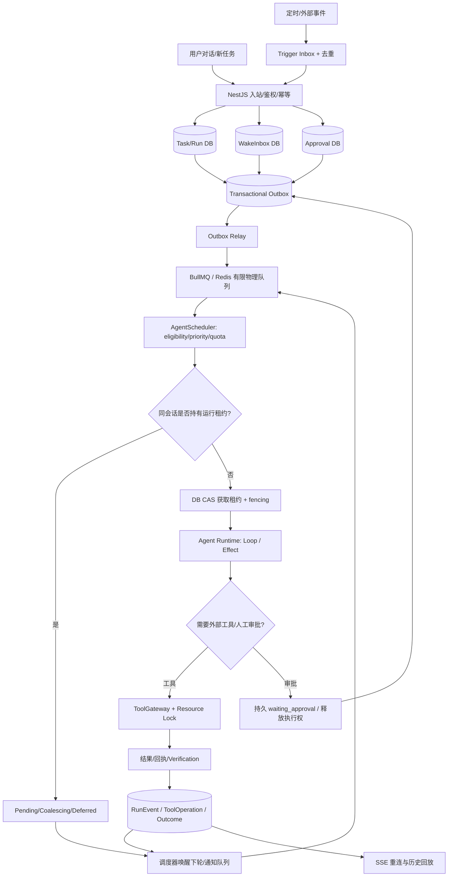
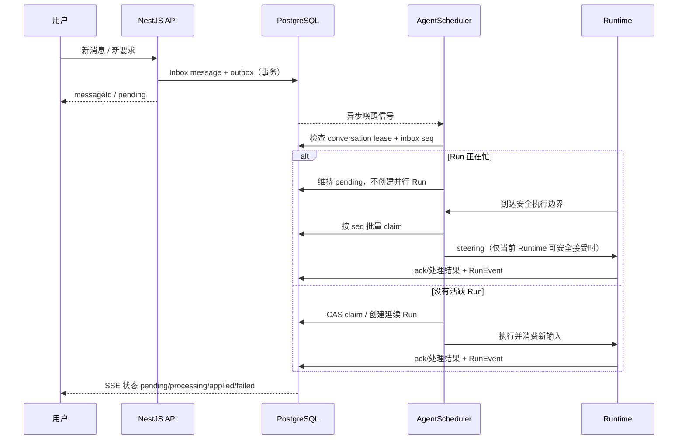

# Personal Agent 队列、唤醒和调度系统技术方案（V1）

> 状态：**待实施设计**；本文件为 `01-ARCHITECTURE` 和 `02-ROADMAP` 的规范性补充，2026-10-26。当前 `agent-app` 有 Effect 编排器与内存 `StateStore`，**尚未具备这里的持久 Task/Wake/Trigger 队列和跨重启调度能力**。实现必须分阶段推进，不能据此标记已完成。
>
> **目标**：单用户自托管可用，数据模型预留多用户隔离；支持用户自建多个 Agent、后台任务、持续目标、消息介入、审批、资源互斥与断电恢复。设计遵循**DB 保存事实，队列负责通知与调度，Runtime 负责具体执行**。

## 1. 为什么 BullMQ 不等于完整的队列架构

BullMQ 能传递 job、延时与有限次重试，但无法自动处理 Agent 的会话语义：忙碌时新用户消息该合并还是排队，执行何时允许被打断，多个 Agent 共享浏览器 Profile 怎样互斥，审批挂起时如何释放 Worker，外部动作超时是否已经成功，以及哪些通知不应引发任务重跑。这些必须由应用的 `AgentScheduler`、PostgreSQL 状态机、`LeaseManager` 和 `ToolGateway` 处理。

本项目**不为每个用户创建一个 Redis 物理队列**。物理队列数保持有限；用户/Agent/会话/资源维度的逻辑队列由 PostgreSQL 记录和调度。

## 2. 六类逻辑队列和作用域

| 逻辑队列 | 消息来源 | 作用域/串并行规则 | 最初建设 |
| --- | --- | --- | --- |
| **Task Queue** | 创建任务、已满足依赖的子任务、手动重跑 | 同一 `conversationId` 顺序推进；不同 Agent/会话允许按额度并行 | P2 |
| **Wake Queue / Inbox** | 用户向正在运行的 Agent 追加消息、恢复、待处理的指导 | `ownerId + agentId + conversationId` 顺序消费；不直接创建第二个同会话 Run | P2 |
| **Approval Queue** | ToolGateway 产生的审批请求、用户裁决、到期 | `approvalId + operationId`；等待不占用 Worker/浏览器锁 | P2 |
| **Tool Queue** | 耗时或资源独占的受控执行动作 | `resourceKey`（如 browserProfileId）独占；短 API 查询按受控并发运行 | P4 |
| **Trigger Queue** | 定时目标、Webhook、事件订阅、轮询发现变化 | `goalId + triggerId + occurrenceKey` 去重，受 Goal 重叠策略约束 | P6 |
| **Notification Queue** | 任务完成/审批提醒/主动反馈 | 与业务 Run 独立发送与重试；通知失败不重跑 Run | P6；P2 建事件出口 |

可选择 BullMQ 物理队列：`agent-runs`、`tool-operations`、`notifications`；定时触发可使用 scheduler + `triggers` 表扫描，审批用 DB 持久状态 + 唤醒 job，Wake 用 DB inbox + 调度器信号。**逻辑六类不等于六个 Redis queue 实例**。

## 3. 总体数据流



**精确定义**：SSE 只投递 RunEvent 给客户端，不是派发命令，也不拥有执行生命周期。Agent/任务的唤醒由持久化记录和调度器驱动，不能依赖前端一直在线。

## 4. 队列隔离、并发和公平性

### 4.1 推荐默认值（可配置，首版简单）

- **同一 `ownerId + agentId + conversationId`**：最多一个 active Run，防止同一会话同时写上下文；可存在多个 pending message。
- **不同会话/不同 Agent**：允许并发，但受用户总并发配额、模型请求速率、内存与工具能力限制。首版单 VPS 可先配置 `maxConcurrentRunsPerOwner = 2`、`maxConcurrentRunsPerConversation = 1`；是**初始建议，不代表硬编码值或实测容量**。
- **共享浏览器 Profile**：`resourceKey = browser-profile:{profileId}` 同时只许一个 writer，Agent 控制与人工接管互斥；不同 Profile 可并行但受 Browser Worker 容量限制。
- **外部接口**：按 Provider/credential 限流、并发许可；写入操作受审批和幂等策略双重限制。
- **队列公平**：先实现 FIFO + 每用户配额 + 紧急审批恢复优先；P7 再评估 aging/加权公平，避免某用户或某会话持续唤醒饿死其他任务。
- **优先级**：明确优先级层级，并为高优任务设置配额；“唤醒信号”不等于任意抢占正在进行的不可中断操作。

**重要**：区分 `Task Queue` 的“业务上有一件事要做”与 `Wake Queue` 的“有新输入/状态变化需要同一运行上下文处理”。它们都能触发调度，但必须去重，不能为一条消息同时创建两个独立 Run。

### 4.2 任务重叠策略（按 Goal 设置）

- `QUEUE`：保留下一次 occurrence，上一 Run 完成再执行。默认用于用户明确要求不得漏执行的任务。
- `SKIP`：已有 active Run 则记录 skipped occurrence，不再执行。适合允许跳过的频繁巡检。
- `COALESCE`：合并多次同类触发为一次待执行并保留来源/次数。适合价格变化、内容更新。
- `REPLACE`：仅在能够安全中断且**确认外部动作状态**时，取消旧 Run 并派发新 Run；不能直接强杀副作用后重跑。

## 5. 重点场景和处理规范

| 场景 | 正确行为 | 不允许行为 |
| --- | --- | --- |
| Agent A 运行中，用户创建 Agent B 任务 | 进入 Task Queue；容量允许且无共享资源冲突时并发 | 因单 Agent 忙碌阻塞所有 Agent |
| 同会话正在回答，用户追加一条消息 | 落 WakeInbox；下个安全边界 steering，或当前 Run 结束后创建延续 Run | 并行运行同一 conversation 的第二个工具循环 |
| 同一消息被重复投递（HTTP 重试/消息渠道重投） | `inboundIdempotencyKey` 唯一约束；只保留一个 InboxRecord | 每重试一次增加独立任务 |
| 定时目标在上一轮执行期间再次到期 | 按 `QUEUE/SKIP/COALESCE/REPLACE` 生效 | 不区分目标直接重复派发 |
| 任务等待用户审批 | 持久 `waiting_approval`，释放 Worker/Run lease 及不需要保留的资源锁；审批后重新排队 | Worker 占住并发槽等待几小时 |
| 用户拒绝/超时审批 | 进入确定的拒绝/超时分支，Run 继续走失败/替代方案，不沿用旧批准 | 超时后使用缓存批准执行 |
| Agent 在浏览器操作中用户接管 | 在可确认的安全边界暂停，获取浏览器控制权；交还后重新观察网页 | 人工与 Agent 同时点击 |
| 工具 API 超时但实际可能发出写请求 | ToolOperation 标 `unknown`，查询回执或交人工核对后再决定 | BullMQ 自动重试导致重复支付/发邮件 |
| Worker 异常退出/Redis 重投 | 先 DB CAS/lease fencing 判断所有权并核对副作用结果；可安全恢复才续跑 | 把 Redis at-least-once 投递当作 exactly-once 业务执行 |
| 运行中取消 | 写入 cancel intent，传播 AbortSignal；确认终局后释放租约并写事件 | 只删除 Bull job，导致已运行工具无主 |
| 通知发送失败 | 独立重试通知，Run 保持已完成状态 | 再次执行原业务任务 |
| 同用户两 Agent 共享一个 Browser Profile | 使用资源独占锁/排队；另一个 Agent 等待或使用不同 Profile | 两者争用同一浏览器会话 |

## 6. Wake Queue 详细机制（区别于普通任务）



- 所有**会改变 Agent 行为的用户消息**写入持久 `ConversationInbox`；是否新建 Task 由 intent router 判定，不要求 `@agent` 前缀。
- `wakePending` 是可聚合的唤醒信号，Inbox 消息正文仍逐条保存，**合并信号不合并/丢失用户输入**。
- 优先消费顺序：同会话按递增 `seq`；只能在原 Runtime 明确支持 steering 的执行边界注入。若不支持，则将消息延后至当前 Run 结束，启动 continuation Run。
- `pending → processing → applied` 用于 UI 感知；另有 `failed/deferred/cancelled`，其中 `applied` 表示输入**被采纳/处理**，不表示外部任务成功。
- 投递 `unknown` 与“模型可能收到输入”之间，不能用无凭据的本地猜测强行判成未送达。若无 Runtime ACK，先保持 unknown/需核对；只有有证据表明输入未消费时才重新提交。无需照搬 OpenCode 特定 marker 心跳阈值。
- Agent 主动唤醒、用户评论、系统恢复统一经过 WakeInbox + Scheduler；权限、去重与优先级仍区分不同来源。

## 7. 数据库与原子性契约

P1 建模、P2 实施基础字段。建议表及唯一约束：

- `tasks`, `runs`：`owner_id`, `agent_id`, `conversation_id`, `state`, `priority`, `version`。
- `conversation_inbox`：`id`, `owner_id`, `agent_id`, `conversation_id`, `seq`, `source`, `payload_ref`, `dedupe_key`, `state`, `claimed_by_run_id`, `created_at`, `applied_at`；unique `(owner_id, conversation_id, seq)`、`(source, dedupe_key)`（真实设计需按源区分唯一性与空值行为）。
- `queue_entries`（可选业务排队视图）：`id`, `kind`, `owner_id`, `scope_key`, `entity_id`, `state`, `priority`, `available_at`, `attempt`；unique `(kind, entity_id, dedupe_generation)`。
- `execution_leases`：`scope_key`, `owner_run_id`, `epoch`, `expires_at`, `last_heartbeat_at`；释放后保留 epoch tombstone（不清零）避免 ABA。
- `tool_operations`：`run_id`, `operation_id`, `external_idempotency_key`, `argument_hash`, `state`, `external_receipt`。
- `approvals`、`triggers`、`trigger_occurrences`、`notification_deliveries`、`outbox_events`、`run_events` 独立记录。
- 对同一会话“最多一个活跃 Run”的约束必须通过 DB 事务/CAS、唯一活跃槽或 lease 原子分配实现，不能只使用进程内 mutex。过期租约重分配 `epoch + 1`，旧 Worker 更新必须携带 epoch 并被拒绝。
- 同一 Task 创建、Run 入库、Outbox 入库在**同一 PostgreSQL 事务**完成；Outbox Relay 扫描并重发至 BullMQ（稳定 jobId），成功后记录投递状态。Relay 崩溃可以重复投递，但 Consumer 按 DB 状态去重。
- `BullMQ job completion` 是传输事件，不是业务 `Run succeeded` 事实；对外展示从 PG 读状态。
- `run_events` 给每个 Run 分配单调 seq，SSE 使用 event id / afterSeq 回放；通知、审批、执行的状态独立。

## 8. Dispatcher / Worker 调度规则

推荐首版采用以下流程（伪代码语义，不代表现有实现）：

```text
inbound request
  -> authenticate + dedupe + DB transaction(inbox/task/outbox)
  -> outbox relay -> BullMQ signal
  -> scheduler selects eligible job
  -> enforce per-user quota + per-conversation serial lease + resource constraints
  -> DB CAS claim + increment lease epoch
  -> load agent version + checkpoints + pending user messages
  -> run RuntimeAdapter (not tied to HTTP connection)
  -> commit checkpoints + events + ToolOperation/Verification
  -> completion/release/continuation, then requeue eligible work
```

长任务不在单个 Redis job 的成功回调里才保存状态：每个关键状态迁移和工具操作边界都必须落盘。BullMQ stalled、at-least-once 或恢复重复调度不能直接重新执行不可幂等操作。可设置 `maxConcurrentRunsPerOwner` 等容量参数并记录调度指标。

## 9. 阶段验收矩阵（P2 必须覆盖）

| 案例 | 断言 |
| --- | --- |
| Q01 同 Agent、同会话短时间 10 条消息 | 顺序保持；无并行 Run；没有丢条 |
| Q02 两 Agent 同时提交任务 | 无资源冲突时可并行；各自上下文隔离 |
| Q03 任务运行中刷新/关闭 Web | 后台 Run 继续；SSE 重新订阅可回放 |
| Q04 重复 HTTP 请求/Outbox 重放/BullMQ redelivery | 只创建一个对应业务意图；不会重复外部副作用 |
| Q05 Worker claim 后进程崩溃 | lease epoch/fence 阻止旧 worker 覆写；可安全恢复 |
| Q06 工具成功但响应超时 | unknown 挂起核对，不重复写外部系统 |
| Q07 审批等待期间新增消息 | 审批持久化；新消息 pending；无额外活跃 Run |
| Q08 同资源 browserProfile 两个 Agent | 同时最多一个控制者，交还后重新观察 |
| Q09 同 Goal 连续触发三次 | QUEUE/SKIP/COALESCE/REPLACE 各自结果符合策略 |
| Q10 完成后通知失败 | Run 成功保持不变，仅通知独立重试 |
| Q11 重复取消与取消/完成竞争 | 终态只会收敛一次，无悬挂 lease |
| Q12 不同用户/Agent 数据与配额隔离 | 一方无法读取/执行另一方的任务/工具 |
| Q13 Wake 信号先到、DB transaction commit 延迟 | Relay 重试后最终可处理，不丢唤醒 |
| Q14 恢复过程旧执行者重新上线 | epoch fence 仍有效；unknown 外部操作不会自动重放 |

P2 **完成定义**：Q01–Q07/Q10/Q11/Q13/Q14 至少完成确定性与容器集成测试；Q08 P4 完成、Q09 P6 完成、Q12 在 P1/P2 至少验证 DB/权限边界。不能因为尚未连接真实第三方服务而宣布外部支付幂等已通过。

## 10. 旧项目代码对接与落地边界

- 复用 `packages/engine/src/agent-loop.ts` 的 `signal/onEvent/onStep` 接缝；改由 Worker 传递业务取消信号，不再把 SSE close 解释为后台 Run 必须停止。旧即时 chat endpoint 兼容保留原行为。
- 复用 `packages/engine/src/orchestrator/` 的 DAG/策略，但新增持久 `StateStore`，不让 `MemoryStateStore` 承担生产恢复。
- 复用 `tools/idempotency.*` 的设计和测试，**不可**把 Redis 锁当外部交易完成回执；业务层 `ToolOperation` 持久化。
- 复用 `telemetry/events` 与 `verification`，向 RunEvent 追加 `queue.enqueued`, `queue.claimed`, `queue.deferred`, `queue.retry_scheduled`, `wake.pending`, `wake.applied`, `lease.expired` 等受控枚举（新增协议应兼容旧 consumers）。
- 新建 `apps/worker` 的 `AgentScheduler`、`WakeInboxService`、`LeaseManager`、`OutboxRelay`，以及 `packages/db` 的 Repository/Prisma migrations。
- P2 优先实现 Task + Wake + Approval **逻辑队列**。Tool（P4）、Trigger / Notification（P6）随后加入同一规范，不在 P2 造六套抽象重复代码。

## 11. PR 切片（OpenCode 实施）

- `docs/queue-state-machine`：冻结消息/任务/Run/Wake/租约/审批契约与状态迁移图。
- `feat/queue-schema-outbox`：Prisma + 唯一约束 + Outbox/Inbox/Lease/ToolOperation 事务。
- `feat/queue-scheduler-worker`：BullMQ Relay、调度器、租约 CAS、Worker 实际消费与恢复。
- `feat/wake-inbox-runtime`：用户消息落库、忙碌 deferred、串行 steering/continuation、ACK。
- `feat/queue-approval-resume`：审批持久化、唤醒、超时、恢复与状态可见。
- `feat/queue-events-web`：队列视图、Run 状态、消息 pending/processing/applied 与 SSE 回放。
- `test/queue-recovery-matrix`：Q01–Q14 中 P2 必需故障矩阵、重复投递/断电和 CI 门禁。

每个 PR 附数据迁移策略、旧 chat 回归结果、故障注入证据及明确未完成项。
