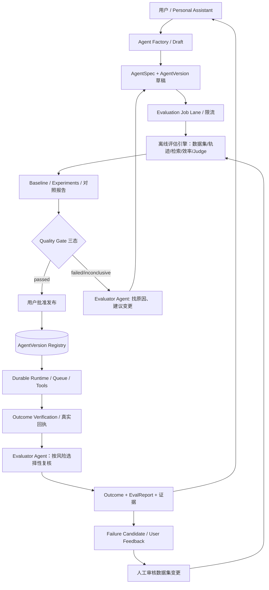
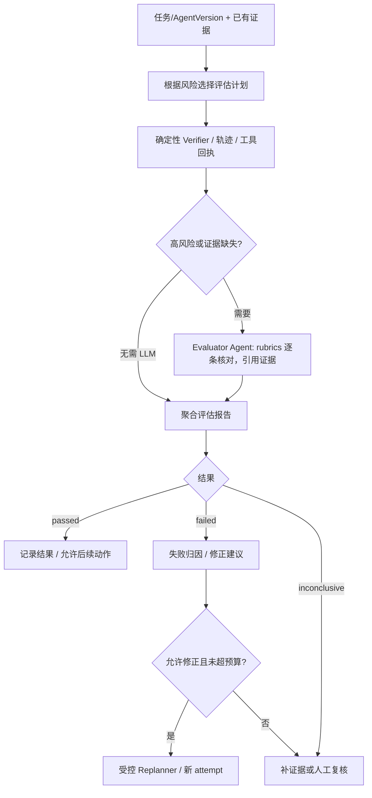

# Personal Agent 质量评估体系设计（V1：复用 agent-app Quality Engineering）

> **状态**：架构设计，新增 Personal Agent 集成尚未落地；核查 2026-10-26 `main` 代码。与 [架构](./01-ARCHITECTURE.md)、[场景矩阵](./04-SCENARIO-MATRIX.md)、[计划](./02-ROADMAP.md) 同时生效。**不可把“已经有评分器”解释为“已经有完整 Evaluator Agent 平台”。**

## 1. 复用基线：现有实现 VS 平台缺口

| 类别 | 现有具体文件/机制 | 复用程度 | 需新增或明确边界 |
| --- | --- | --- | --- |
| **Offline Evaluation** | `engine/src/evals/runner.ts`、`dataset.ts`；trajectory/routing/retrieval/judge 四套件 | 直接复用 | 不同用户 AgentSpec 的独立数据集与任务覆盖 |
| **Outcome Verification** | `engine/src/verification/`：Schema/ToolExecution/Artifact 验证与三态 `passed/failed/inconclusive` | 复用 | Run/Artifact/ToolOperation 真实回执接线、证据持久化 |
| **LLM-as-a-Judge** | `evals/scorers/judge.ts`：rubric v1、二元校准、可带 evidence | 复用评审函数 | 面向每个 Agent 的领域 rubric、judge 校准、质量偏差监控 |
| **Trajectory/Tool Routing** | `evals/scorers/trajectory.ts`、`routing.ts` | 复用 | 多 Agent 委派/工具参数和风险的轨迹校验 |
| **RAG Evaluation** | `evals/scorers/retrieval.ts`：Recall@k、MRR | 复用 | 引文可追溯性/忠实性、memory 泄漏与时效性评测 |
| **Efficiency** | `evals/scorers/efficiency.ts`：工具次数/总耗时上限 | 复用 | Token/成本、队列等待、任务 P95、外部 API 预算 |
| **Quality Gate** | `evals/quality-gate.ts`：R1–R6，FULL 与 CI_TIER1，三态结论 | 复用纯判定函数 | 发布工作流、风险分级、自动汇入 verification/reliability/security 摘要 |
| **Regression/Baseline** | `evals/baseline.ts`：版本/configId 与回归容差 | 复用 | AgentVersion 级可审阅基线及 CI/CD 门禁、版本迁移 |
| **Evaluation Governance** | `evals/governance.ts`：7 维 metadata、critical cases、来源、reviewStatus | 复用 | safety/reliability 独立正式 suite（当前仅有治理维度与链路测试，非独立评分套件） |
| **Reliability/Security tests** | `test/reliability.spec.ts`、`security-chain.spec.ts`、原 guardrails 红队 | 复用测试和 fixtures | Personal Agent SC01–SC54 队列、权限、浏览器、长期目标故障矩阵 |
| **Experimentation** | `evals/experiments.ts`：重复运行、统计均值/样本标准差/正态近似 95% CI、P50/P95、configId、`compareReports` | 复用 | 自动化候选模型/Prompt/AgentVersion 对照实验、在线影子评估和成本核算 |
| **Failure Feedback** | `evals/failure-cases.ts`：候选 JSONL、PII 脱敏、内容哈希去重、人工审核 | 复用 | 任务失败/用户反馈自动**提名**为候选，人工审核后才可进入正式集 |
| **Evaluator Agent** | 尚无统一面向用户自建 Agent 的独立评估服务/工作流 | **新增** | 目标分解、rubric 生成、证据检索、失败归因、有限次建议/重规划，不得修改权限或门禁 |

**准确状态**：当前 `EvalSuiteName` 仍是 `trajectory|routing|retrieval|judge` 四种，虽然 `governance.ts` 声明了 `correctness/tool-usage/trajectory/retrieval/safety/reliability/efficiency` 七个维度。安全与可靠性有独立测试覆盖，但**没有因此自动变成正式 EvalSuite**；`quality-gate.ts` 中的 `checks` 是未来接 verification/security/reliability 的扩展接缝，不能说已经全链路自动汇聚。现有实验台账是本地 `.data/experiments.jsonl`；基线通常位于 gitignored `.data/eval-baseline.json`。这些都不是 Personal Agent 多用户持久化评估平台。

## 2. 分层架构：不要把 Evaluator Agent 与评分系统混为一谈

三类执行职责严格分开：

- **Verifier**：确定性、可追溯，检查文件/Schema/工具回执是否满足约束；关键外部动作没有确切证据时返回 `inconclusive`。
- **Evaluator Agent**：用 rubrics、用户目标、真实证据解释结果、查漏、建议重规划；**不能直接覆盖 Verifier 的硬失败或权限拒绝**。
- **Quality Gate**：纯函数接多源报告进行阻断决策；发布依据 AgentVersion 的完整风险策略，由业务 Workflow 执行发布操作。

## 3. 四个评估时机

| 时机 | 主体 | 阻断权限与成本 |
| --- | --- | --- |
| **A. Agent 创建/变更时（Pre-publish）** | Factory + Offline Eval + Quality Gate | 必跑关键用例失败/缺席时不发布；高风险 Agent 必须人审 |
| **B. 执行过程中（Online/Step）** | ToolGateway + Budget + Policy + Trace + 轻量 deterministic checks | 受控工具调用前同步阻断；LLM 评审只在高风险/不确定/达到阶段边界时运行，避免每一步额外烧模型 |
| **C. 任务结果验收（Post-run）** | Verification → 可选 Evaluator Agent → Outcome | `Run succeeded` 不等于 `business objective accepted`；证据不足时 `inconclusive` 不冒充成功 |
| **D. 持续质量改进（Periodic/Regression）** | Dataset governance + Experiments + Human review | 发现退化可自动标记需复评/阻止后续高风险发布；不得未授权地自动改正式标准/自动升级线上版本 |

Evaluator Agent 是可以被 Factory 发布的**受限系统型 Agent**，但评估输出只是**证据及建议**，不拥有高危工具权限、不持有被评 Agent 的私人密钥、不直接修改生产 AgentSpec/数据集/基线和 Quality Gate。

## 4. 可执行评估维度（设计口径）

| 维度 | 确定性/统计评估 | LLM Judge/人工补充 | 门禁 |
| --- | --- | --- | --- |
| correctness | 输入输出 schema、用户验收清单、工具最终回执 | rubric 中事实准确性和缺失项 | 核心验收失败阻断 |
| tool-usage & trajectory | 工具使用集合/顺序/参数、越权和重放检验 | 复杂多步计划合理性 | 高危错误动作一票否决 |
| retrieval & grounding | Recall@k、MRR、来源、检索 owner ACL | 回答是否忠实于证据、是否引用错误 | 关键无来源结论不自动通过 |
| safety | PII、注入、权限、审批、跨用户数据访问、外部副作用 | 含歧义风险解释 | 越权/泄漏绝不靠平均分抵消 |
| reliability | 重试/取消/超时、队列 SC01–SC54、故障注入、资源锁 | 失败归因与补偿方案 | 重复写操作/无主任务阻断 |
| efficiency & cost | 工具调用数、耗时、Token 实测/缺失标 unknown、费用 | 结果质量与成本平衡 | 超预算停止，不以省钱放松安全 |
| multi-agent & long-term | DAG/子任务成功率、Goal recurrence、委派权限交集、通知送达 | 跨阶段目标完整性 | 未完成依赖不能冒称 Goal 已完成 |

## 5. 三态评估与修正策略

- 必查 Verification 或 Eval 存在**确定失败**：`failed`，不可继续发布或将 Task 标成功；可以产生诊断候选，允许有界 Replanner。
- 必须评估的输入证据不足、模型评审不可用或验证器异常：`inconclusive`，进入补证据/人工审核；不得显示“已通过”。
- 必查项全部执行且通过：`passed`，然后再做授权/版本/预算核查和发布/业务成功状态转换。
- 对安全性高风险操作采用**确定性策略优先**。LLM Judge 的置信程度不能替代权限校验。
- Replanner/Reflection 有**最大修正轮数、token/时间预算、停止条件、审批保留规则**；不得形成自己评自己无限循环。没有新的证据或明确计划差异时，停止重试并向用户说明。

## 6. 评估 Job 与队列系统对接

**新增逻辑 Evaluation Lane**（六条核心业务 lane 外的质量工作车道），不强制新建单独的 BullMQ 物理队列：

- **Pre-publish**：`factory.draft → evaluation_job → report → quality_gate → publish_approval`；可以使用 `agent-runs` 的独立优先级/并发池，生产容量不足时单设 `evaluations` worker。
- **Post-run**：RunOutcome、VerifierEvidence 写 DB → Outbox 发 eval requested → 评估 worker 聚合 report；**评估 worker 重试不能重新调用业务工具**。
- **Periodic**：低优先级重放离线 datasets/实验，固定 `agentVersionId + datasetVersion + evaluatorVersion + modelConfigId + rubricVersion`；受 owner 模型/费用预算约束。
- **Feedback**：真实任务失败、人工纠错、安全事件生成脱敏候选；去重并等待审核；**禁止自动把 Agent 输出升格为 Golden Dataset**。
- 状态：`queued → running → passed|failed|inconclusive`，另有明确 `cancelled/timed_out`；Queue 传输状态与 Evaluation 业务结论分开；`inconclusive` 可安排补证据而非盲重试模型。
- 数据：建议 `evaluation_jobs`, `evaluation_runs`, `evaluation_cases`, `evaluation_reports`, `eval_datasets`, `eval_baselines`, `review_decisions`, `failure_candidates`；设计 ownerId / agentVersionId / runId / parentEvaluationJobId / testConfigId / evidenceRef，支持审计和版本对比。**P1 定义基础 schema，P3 实施产品级 Eval 业务表**。

## 7. Evaluator Agent 的工作流和安全边界

- Judge 输入必须是**脱敏的必要证据**，防止评估 Agent 访问无权限的私人资料。Rubric 与 Prompt 分离且版本固定，LLM output 仅作为判分候选。
- 评估的结果包括依据（证据引用）、可复现 failure type、分数/通过状态、建议而不是只有一个总分。
- 可以采用少量人工校准集分析 Judge 的误放与误杀；避免用同一模型无限“自我肯定”。
- 评估服务允许与 Runtime 异步交互，但不能让普通聊天每个 token 都走重型 Judge。
- `Evaluator Agent` 可利用原有 `createLlmJudge`，但目前该 Judge 面向**客服校准数据**，新增领域化 AgentSpec、Dataset、评审证据接口而不是简单直接复用客服 Prompt。

## 8. 实施阶段（与 Roadmap 严格对齐）

| 阶段 | 工作 | 验收 |
| --- | --- | --- |
| **P0** | 清点 Eval / Verification / Gate / Experiments / Feedback 的真实版本、测试/CI 缺口 | 保留全部既有测试、现有用例状态不被误报 |
| **P1** | 定义 AgentVersion/EvaluationJob/Report 基础 DTO 与身份、DB scope | 不能跨 user/Agent 读取报告 |
| **P2** | 为 Durable Run 落真实 Trace、ToolOperation 回执、VerificationEvidence；Outbox 准备事件 | 执行成功与验证结论可独立查询；故障 SC01–54 有证据 |
| **P3** | Agent Factory 发布前 Eval + Quality Gate；领域 Dataset、Evaluator Agent V1（诊断/解释）、人工发布 | 关键用例失败不允许发布；并发 Factory job 不串数据 |
| **P4–P5** | 增加 Tool/Browser 副作用评测，RAG/Memory 忠实性/隔离评测 | 无越权、无重复副作用、删除后检索不会泄漏 |
| **P6** | Goal/Trigger、主动通知的长期质量评估与样本收集 | 重复触发/misfire/通知与真实成果一致 |
| **P7** | 多 Agent 委派评估、实验对照、在线采样/漂移检测、可审计回归门禁、可选 Eval 专用 worker | 单/多 Agent 端到端质量与成本可解释 |

**P3 发布门禁细节**：新 AgentSpec 不存在对应的金标准测试时不能“默认通过”；最低限度先人工审核目标、权限、关键场景，跑与其能力相关的通用测试，标记剩余覆盖缺口。高风险 Agent 要求独立领域用例与人审证据。

## 9. 新场景（补充 SC，不重写已冻结的 SC01–SC54）

建议另建 **E01–E12** 场景组，与业务 SC 编号独立避免修改既有约束：

| 场景组 | 必测情况 |
| --- | --- |
| E01–E03 Factory | 没有 golden dataset、评审不可用、关键用例失败时是否阻断发布 |
| E04–E06 Runtime | 工具声称成功但回执失败、验证证据缺失、Judge 与 Verifier 冲突 |
| E07–E09 Safety | 评审证据包含 Prompt Injection、跨用户 Eval 数据泄漏、评估费用超限 |
| E10–E12 Improvement | 同一失败重复入候选、人工拒绝候选、Agent 试图自动修改基线或安全门禁 |

每个实施 PR 标注 E 编号、测试文件、环境、执行结果、关联风险及未验证项。**没有数据就显示 inconclusive/未验证，不以 0 或通过填充。**

## 10. 产品级评估报告视图

建议在 AgentVersion 和每次 Run 上展示：
- 概览：通过/失败/证据不足，关键项阻断情况，最近可比基线与是否回归。
- 能力维度：correctness / tool usage / grounding / safety / reliability / efficiency / cost，各自来源、样本量和测试环境。
- 证据：Trace、ToolOperation 真实回执、Schema/Artifact 验证、Judge rubric、用户反馈。
- 变化：Agent v1→v2、模型/Prompt 调整、失败候选、实验多次运行区间（小样本只能描述，不给确定性保证）。
- 风险：不可自动重放操作、缺失授权、未验证连接器、过期数据及人工待办。

**执行层收益**：Factory 能决定是否允许发布，Worker 能明确业务真实完成状态，用户可以知道自己的 Agent 是否可靠，平台可以持续回归和改进，而不产生第二套与原来矛盾的质量门禁。
